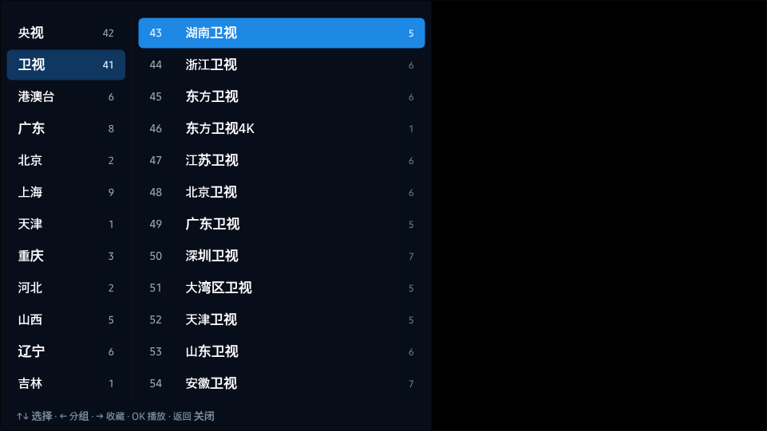
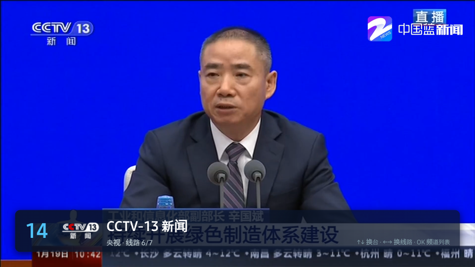
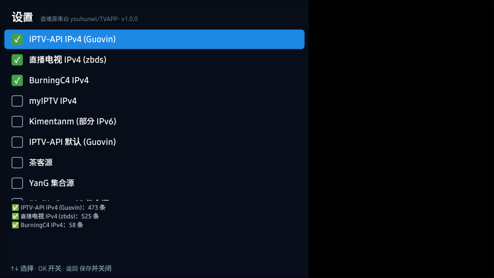

# samsung-tvbox

Live TV for Samsung TVs (Tizen): CCTV, 卫视 (湖南, 浙江, 东方, 广东…), 广东 and other provincial channels, Hong Kong/Macau/Taiwan and themed channels. It plays the free IPTV lists collected by [youhunwl/TVAPP](https://github.com/youhunwl/TVAPP#直播源-), and you drive it with the remote.



## What it is

TVAPP is not an app with source code. It's a catalogue of Android TV APKs (TVBox, 我的电视, 酷9直播…) plus a list of live-source subscriptions in M3U/TXT format. Android APKs can't run on a Samsung TV, so this repository is a new Tizen web app that does what the TVAPP live-TV players do: it loads those subscriptions and plays them.

The app is built like [samsung-bilibili](https://github.com/owen800q/samsung-bilibili): React with Vite, compiled down to a classic bundle that runs over `file://` on Tizen 4.0+ (2018 TVs onward). Remote keys are registered through `tizen.tvinputdevice`, and the TV plays HLS natively.

| | |
|-|-|
| Sources | 3 TVAPP subscriptions are on by default (Guovin IPTV-API IPv4, zbds IPv4, BurningC4); 12 more can be switched on in 设置. You can also add any M3U/TXT URL. GitHub raw URLs fall back to `gh-proxy.com` and `ghfast.top`. |
| Lineup | Every subscription is merged by channel. `CCTV-1`, `CCTV1综合` and `CCTV-1 HD` become one channel. Each channel keeps every URL found for it as a separate **line** (typically 5–20). Groups: 收藏, 央视 (CCTV-1…17 in order), 卫视 (湖南, 浙江, 东方, 江苏, 北京, 广东…), 港澳台, provinces (广东 first, with local stations such as 广东珠江, 广东体育 and 广州综合), then the sources' own groups (电影, 纪录, 直播中国…). |
| Playback | Public lists are full of dead links. On a channel change the app tries the first 8 playlists at once and starts with the fastest that answers, or with the line that last worked for that channel. A line that errors, doesn't start within 10 s, stalls for 12 s or turns out to be a recording moves on to the next line. Stand-in clips (a "source expired" `.mp4`, or Kuaishou/Douyin recordings listed under a live channel's name) are dropped when a channel has any live line. |
| Startup | Opens straight into the last channel. The lineup comes from the cached playlists, and is refreshed in the background every 6 hours. |

## Remote

| Key | Watching | Channel list |
|-|-|-|
| ↑ / ↓ | previous / next channel | move |
| CH+ / CH− | next / previous channel | page |
| ← / → | previous / next line | ← groups · → add/remove 收藏 |
| OK | open the channel list | play |
| 0–9 | go to a channel number | |
| ▶ | retry the current channel | |
| Back | press twice to exit | close |
| Red / Green | 收藏 / 设置 | |

The Samsung Smart Remote has no number or colour keys, so everything also works with the arrows, OK and Back. 设置 is the last entry in the group column.

## Build and install

Requirements: Node 20+, and [Tizen Studio](https://developer.samsung.com/smarttv/develop/getting-started/setting-up-sdk/installing-tv-sdk.html) with the Samsung TV extension and a Samsung certificate profile whose distributor certificate lists your TV's DUID.

```sh
cd app
npm install
npm test                                     # unit tests
npm run package -- --profile <profile>       # → build/TVBoxLive.wgt (signed)
../scripts/tv.sh <tv-ip> <profile>           # build, install and launch on a TV in Developer mode
```

The widget starts through the update loader; `OTA=0 npm run package` builds one without updates. Without the Tizen CLI, `npm run package` writes an unsigned `build/TVBoxLive-unsigned.wgt`; a TV installs only signed widgets. App ID `TVBoxLive0.TVBoxLive`. The version comes from `app/src/version.js`.

### Updates

Installed TVs update themselves from this repository's GitHub releases, with no server of their own. Every push to `main` publishes a release (`.github/workflows/release.yml`) with the widget and the app build. The TV checks `releases/latest` in the background, downloads a new build into storage, and uses it from the next launch. 设置 → 检查更新 checks at once, and 立即重启 switches to a downloaded build. A broken build falls back to the installed one. See [ota/README.md](ota/README.md).

Reinstall the widget only after changing `tizen/config.xml`, the icon or the loader. Each release carries `TVBoxLive.wgt`, signed when the repository has the certificate secrets listed in ota/README.md.

Browser development: `cd app && npm run dev` (http://localhost:5173 at 1920×1080). Arrows, Enter and Esc stand in for the remote. Desktop browsers enforce CORS, so some playlists and streams only load on the TV or in the simulator.

## Testing

- `npm test`: the playlist parsers, channel merging and grouping, line ordering, the probe and failover, and the update loader (`ota/`).
- `npm run check:streams [-- 湖南卫视 广东卫视 …] [--all-sources]`: fetches the subscriptions and tests every line of the main channels from the current network (playlist plus first segment). Use it on the TV's network to see which lines work there.
- `tools/sim-smoke.mjs`: drives the app in the Samsung TV Web Simulator with remote keys:

```sh
cd app && npm run build && cp ../tizen/config.xml ../tizen/icon.png dist/
Xvfb :99 -screen 0 2200x1400x24 &                       # Linux without a display
cd ~/tizen-studio/tools/sec-tv-simulator
rm -rf ~/.config/"tizen tv web simulator"               # start from a clean TV
DISPLAY=:99 ./simulator --file=<repo>/app/dist/index.html --platform=tizentv \
  --tizentvversion=6.0 --remote-debugging-port=9222 --disableInspector
node <repo>/tools/sim-smoke.mjs --shots /tmp/shots
```

Result on 2026-10-20, in Tizen Studio 6.1's TV Web Simulator (v10.0.6, Chromium 137), from a cloud sandbox in the US whose network only reaches ports 80/443: **11 passed, 2 warnings, 0 failed**.

- Tizen APIs present.
- Lineup loads from a cold start: 603 channels in 42 groups (央视 42, 卫视 41, 广东 8).
- CCTV-1 on startup: none of its 6 lines answered from the sandbox. The app went through all of them and showed 所有线路都无法播放.
- Channel list → 卫视 → 湖南卫视: **warning**. The only reachable line (mgtv) is 4K **HEVC**, which the simulator's Chromium can't decode; Samsung TVs decode HEVC in hardware.
- ↑/↓ changes channel (湖南卫视 → 浙江卫视 → back).
- 广东卫视 by number: **warning, unverified**. All of its lines timed out from the sandbox (US/mainland IP:port hosts, and one line whose segments are on port 14311).
- → changes line.
- 东方卫视 by number plays at 1920×1080 (line 5/6, bestv).
- CCTV-13 by number plays at 1920×1080 (line 6/7, cztv).
- Favourites, 设置, and the double-Back exit prompt.

`check:streams` from the same sandbox found an answering line for CCTV-13, 湖南卫视, 浙江卫视 and 东方卫视, but none for CCTV-1, CCTV-5, 广东卫视, 广东珠江, 广东体育 or 广东新闻. That reflects the sandbox's network, not the lists: their lines are on hosts and ports the sandbox can't reach.



### Not verified (needs a physical TV)

- Playback on the TV's own player: native HLS, HEVC/4K lines (such as mgtv's 湖南卫视), and the lines the sandbox couldn't reach (most CCTV, 广东卫视 and the 广东 local channels). Which lines work depends on the TV's network: run `npm run check:streams` from a computer on the same network.
- Cross-origin requests from the packaged app. The probe and the playlist download use `XMLHttpRequest`; `config.xml` grants `<access origin="*">`, which samsung-bilibili relies on in the same way. If the TV blocked them, playlists would still load from GitHub (it sends `Access-Control-Allow-Origin: *`), but the probe would fail silently and the app would try lines in list order, which is slower.
- Number, CH± and colour keys on a real remote.



## Licence

MIT, see [LICENSE](LICENSE). The channel lists are fetched at runtime from their publishers; this repository contains no streams. TVAPP's disclaimer applies to the sources: they are shared for personal study, not for commercial use. An independent community project, not affiliated with Samsung or any broadcaster.
